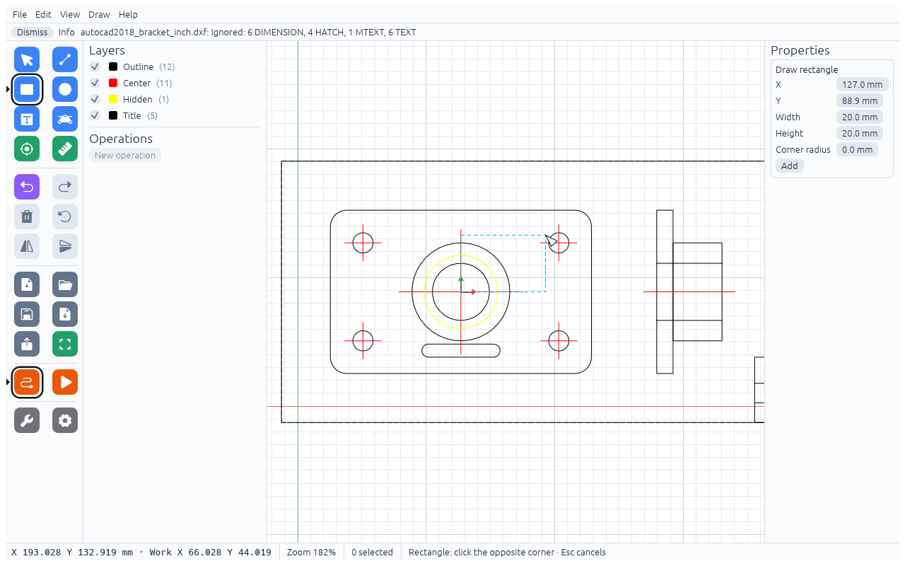
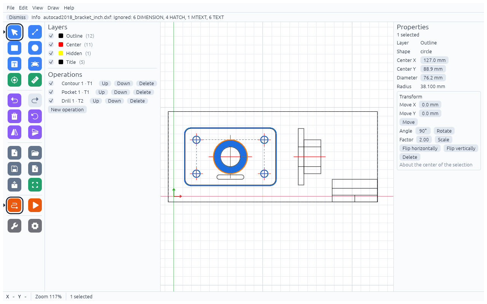
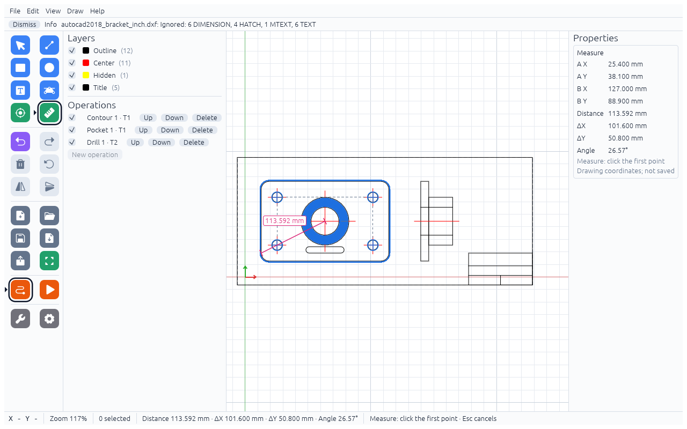
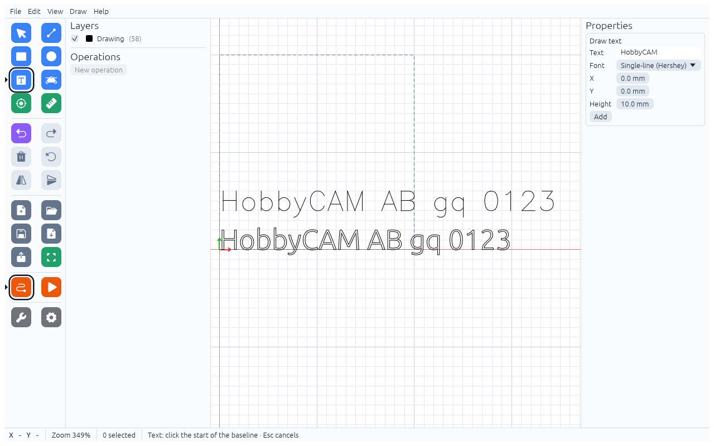

# Drawing

Besides importing DXF files you can draw simple shapes. They go on the layer **Drawing**.

## Shapes

Pick a tool in the **Draw** menu or the sidebar. The status bar tells you what to click; `Esc` cancels.

- **Line** (`L`): click the start point, then the end point.
- **Rectangle** (`R`): click one corner, then the opposite corner.
- **Circle** (`C`): click the centre, then a point on the circle.
- **Text** (`T`): click the start of the baseline.
- **Round corners**: see below.
- **Measure**: see below.

Instead of clicking you can type the values in the form on the right (Properties) and click **Add**:
X1/Y1/X2/Y2 for a line; X, Y (bottom-left corner), Width, Height and **Corner radius** for a rectangle
(a radius above 0 gives a rounded rectangle); Center X/Y and Diameter for a circle.
A click on the canvas fills the same fields.

A drawn shape becomes a plain contour, like an imported one.

## Snaps

While a drawing tool or Set origin is active, the cursor snaps to points within 10 screen pixels.
A small marker and a label show what it found:

| Label | Marker | Where |
|---|---|---|
| End | square | end of an open line or curve |
| Corner | square | a corner of a contour |
| Point | diamond | a DXF point (drill point) |
| Center | circle | centre of a circle or arc |
| Intersection | X | where two lines or curves cross |
| Midpoint | triangle | middle of a segment |

On very large drawings the status bar says "Intersection snaps off: drawing too large".

## Moving and editing

- Drag an item with the Select tool to move it (and everything else selected). The point you grab snaps to the
  item's own corners/centres, the drop point to the snap points of other items (same markers as above). Hold
  `Shift` while dragging to move only horizontally or vertically; `Esc` puts it back. A drag that starts on empty
  space, or with `Shift` held, selects with a box as before.
- Properties shows editable fields for what it recognises, drawn **and** imported: a line (X1/Y1/X2/Y2, Length;
  the start stays put), a circle (Center X/Y, Diameter; also a DXF circle made of two half arcs), a rectangle with
  straight sides along X and Y (X, Y = bottom-left corner, Width, Height, Corner radius; the bottom-left corner stays
  put). Anything else (and several items) shows X/Y of its bounding box: typing a new X or Y moves it there.
- Operations and tabs stay attached to a moved or edited item. Text is one item per stroke/letter outline: select
  it with a box to move it.

## Round corners

**Round corners** (sidebar or Draw menu) rounds sharp corners with an arc of the **Radius** set in Properties. Click a corner (the highlighted corner shows the arc it will get), or select contours first and click **Round all corners of selection**. It works on drawn and imported geometry. Only corners between two straight lines are rounded; corners next to an arc, corners that are already smooth and the ends of open lines are left alone. When the radius does not fit (the sides are too short), the corner is skipped and a message says how many were skipped and why (a click says the largest radius that fits). Undo reverts it; operations and tabs stay on the item. A sharp rectangle rounded at all four corners is edited as a rectangle with that Corner radius.

## Measure

**Measure** (sidebar or Draw menu) shows the distance between two points. Click the first point, move the mouse
(a ruler follows the cursor) and click the second point. Both clicks snap like the drawing tools (line ends,
corners, circle centres, …); without a snap the clicked point is used. The ruler shows the distance, the status bar
and Properties show the distance, ΔX, ΔY (second point minus first) and the angle (degrees counter-clockwise from
the X axis, 0–360). Values follow the units in Settings; X/Y are drawing coordinates. A new click starts a new
measurement; `Esc` clears it (press again to leave the tool). Measurements are not saved and do not change the
project.

## Changing the selection

Select geometry and use the **Transform** box on the right. Everything works around the centre of the selection:

- **Move X / Move Y** and **Move**
- **Angle** and **Rotate** (counter-clockwise; also the Rotate button in the sidebar, using the same angle)
- **Factor** and **Scale** (the same factor in X and Y)
- **Flip horizontally**, **Flip vertically**
- **Delete** (also `Del` or Backspace)

## Undo

**Edit → Undo** (`Cmd/Ctrl+Z`) and **Redo** (`Cmd/Ctrl+Shift+Z` or `Ctrl+Y`) remember the last 100 steps.
A drag or one edit of a field counts as one step.

## Text

The Text form has **Text**, **Font**, X, Y and **Height** (the height of a capital letter).

- **Single-line (Hershey)** gives open strokes: cut them with **Engrave**, the tool runs along the lines.
- **Outline (Ubuntu Light)** gives closed letter outlines: use **Contour** or **Pocket**.

Text is one line, with fixed letter spacing. Characters the font does not have are left out and listed in a
"Not in the font: …" message.
