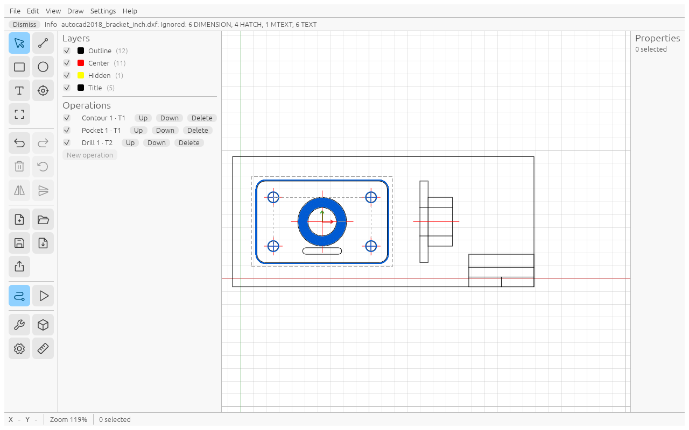

# The window

From top to bottom and left to right:

- **Menu bar**: File, Edit, View, Draw, Help.
- **Messages** under the menu: import notes, export results and errors. **Dismiss** removes one.
- **Icon sidebar** (two columns) on the far left, buttons coloured by group (drawing blue, origin, measure and zoom
  green, edit purple, file slate, toolpaths and simulation orange, tools and settings grey). It has the same commands as
  the menus. Hover a button to see its name and shortcut. The active tool and the toggles that are on have a dark ring
  and a small arrow. Grey buttons cannot be used right now (for example Delete with nothing selected).
- **Layers and Operations** next to the sidebar:
  - the layers of the drawing, each with a checkbox to show or hide it and its item count;
  - the operations in the order they will run, each with an enable checkbox, **Up**, **Down** and **Delete**,
    and a red or orange line such as "1 error" when a check found something;
  - the **New operation** button.
- **Canvas** in the middle: the drawing on a grid, the stock as a dashed rectangle, and the work origin
  as a red (X) and green (Y) arrow. Toolpaths are drawn in blue (View → Show toolpaths turns them off).
- **Properties** on the right shows what you selected last: the settings of an operation (click it in the list), or
  the editable details (position, size) and the Transform box of the geometry you clicked on the canvas, or the
  number form of the active drawing tool. It is hidden when nothing is selected.
- **Issues** panel at the bottom, only when a [sanity check](sanity.md) found something. Click an issue to select its
  operation and item.
- **Status bar**: cursor position (plus "Work X … Y …" when the origin is not the drawing origin), zoom in percent,
  "*n* selected", and the hint of the active tool, for example "Line: click the start point · Esc cancels", and with
  Measure the distance, ΔX, ΔY and angle.
- **Settings** window (**File → Settings…**, `Cmd/Ctrl+,` or the gear in the sidebar): Units, Machine, Stock and
  Snapping. Changes apply at once; Units, Machine and Stock are part of the project and can be undone, Snapping is a
  setting of this computer (kept for every project, not undone). Close it with the X or `Esc`. In this manual
  **Settings → Stock** means the Stock section of this window.

## Mouse

| What you do | What happens |
|---|---|
| Mouse wheel | zoom in and out at the cursor |
| Trackpad two-finger scroll | pan |
| Trackpad pinch, or Cmd/Ctrl + scroll | zoom at the cursor |
| Middle-button drag, or hold Space and drag | pan |
| Click | select one item (click empty space to clear) |
| Shift + click | add an item to the selection, or remove it again |
| Drag an item | move the selection by its nearest key point (Shift while dragging: straight; Esc cancels) |
| Drag a box left to right (from empty space) | select everything fully inside the box |
| Drag a box right to left (from empty space) | select everything the box touches |
| `F` | zoom to fit the drawing and the stock |

Plain-key shortcuts (`F`, `L`, `Esc`, …) work while the mouse is over the canvas and you are not typing in a field.
All shortcuts are listed in [Shortcuts](shortcuts.md).
