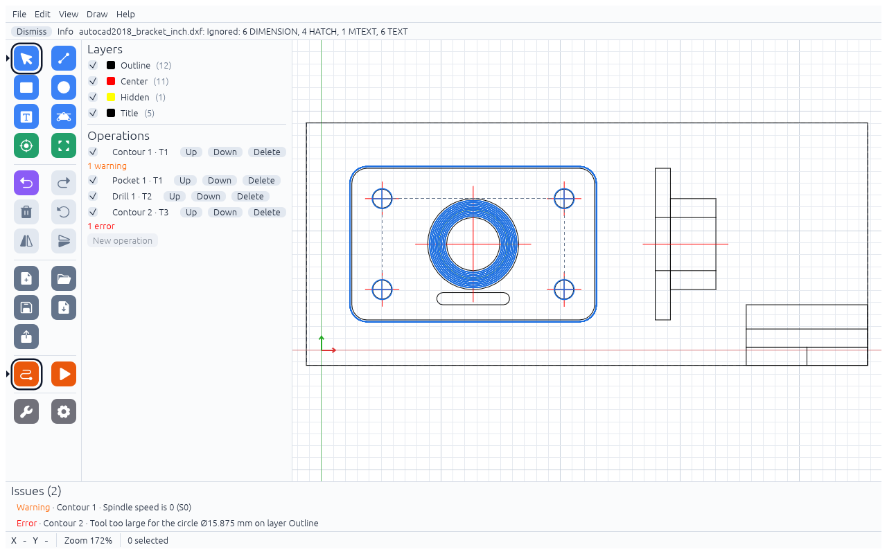
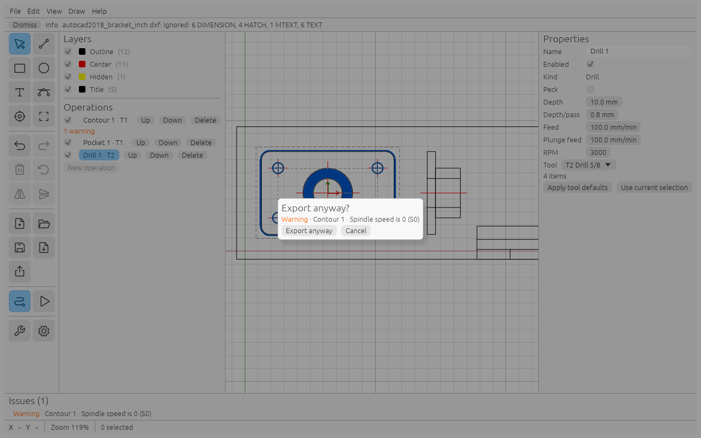

# Sanity checks

HobbyCAM checks the project after every change and once more when you export. What it finds is listed in the
**Issues** panel at the bottom, and under the operation in the list ("1 error", "2 warnings").

- An **Error** blocks the export: File → Export G-code… shows "Cannot export G-code" with the list.
- A **Warning** lets you decide: the export asks "Export anyway?". Read each one before you click **Export anyway**.

Each issue starts with the operation name. Geometry is described by kind and layer, for example
"circle Ø15.875 mm on layer Outline", "closed contour on layer 0" or "point on layer 0".
Click an issue to select its operation and the item.

Below, *n*, *d* and similar stand for numbers, *item* for such a description.

## Rules

### Uses tool T*n*, which is not in the project

**Error**

When: the operation uses a tool number that the project has no copy of (usually a hand-edited or damaged file).

Fix: choose a tool in the operation's Tool list, or add the tool to the library and pick it again.

### Refers to *item*, which does not exist

**Error**

When: the operation lists geometry that is no longer in the project.

Fix: click the operation, `Shift`+click the geometry you want and click **Use current selection**, or delete the operation.

### Id *n* is used more than once

**Error**

When: two items or operations share an internal id. This only happens with a damaged or hand-edited `.hcam` file.

Fix: open an older copy (for example the `.hcam.bak` file), or rebuild the affected part of the project.

### Tool T*n* is embedded more than once

**Error**

When: the project file holds two copies of the same tool number (damaged or hand-edited file).

Fix: as above, use an older copy of the file or remove the duplicate in a text editor.

### Id *n* is not below the id counter

**Warning**

When: an id in the file is not below the file's id counter (damaged or hand-edited file). New items could get the
same id.

Fix: save the project from HobbyCAM; if the warning stays, use an older copy of the file.

### Clearance Z must be greater than 0

**Error**

When: one of the heights in **Settings → Machine** is wrong. The other messages of this rule:

- "Safe Z must be at or above clearance Z"
- "Tool change Z must be at or above safe Z"

Fix: keep 0 < Clearance Z ≤ Safe Z ≤ Tool change Z (defaults 2, 5 and 40 mm).

### Stock *width* must be greater than 0

**Error**

When: **Settings → Stock** has a Width, Height or Thickness of 0 or less ("Stock height must be greater than 0",
"Stock thickness must be greater than 0"), or the stock X or Y is not a number
("Stock position X must be a finite number").

Fix: enter real values in Settings → Stock.

### Invalid value: *name*

**Error**

When: a value of the operation or its tool is not a number or is 0 or less. *name* is one of `depth`,
`depth_per_pass`, `feed`, `plunge_feed`, `stepover_pct`, `peck`, `tab_width`, `tab_height`, `tab_spacing`,
`tabs` (a hand-placed tab position) or `diameter` (the tool's). It also fires for a stepover above 100 %,
and when the job would need more than 10 000 passes (`depth_per_pass`) or 10 000 pocket rings (`stepover_pct`).

Fix: correct the named field in the operation (Depth/pass, Feed, …) or in the tool.

### No geometry assigned

**Error**

When: the operation has no geometry, for example after you deleted all of it.

Fix: click the operation, `Shift`+click the geometry you want and click **Use current selection**, or delete the operation.

### Needs closed contours, but got *item*

**Error**

When: a Pocket, or a Contour with Side Inside or Outside, contains an open contour.

Fix: remove the open contour from the operation, close the gap in your CAD program, or use Engrave or Contour On.

### Cannot use *item* in this operation

**Error**

When: the geometry does not fit the kind, for example a DXF point in a Contour, or a rectangle in a Drill
(Drill takes only circles and points).

Fix: click the operation, `Shift`+click the right geometry and click **Use current selection**.

### Tool too large for *item*

**Error**

When: the tool does not fit: an Inside contour or a pocket narrower than the tool leaves no path at all.

Fix: choose a smaller tool, or use Drill or Contour On for small holes.

### T*n* is a drill bit and cannot mill

**Error**

When: an Engrave, Contour or Pocket uses a tool of type Drill.

Fix: pick an end mill, or change the operation to Drill.

### Depth *d* is deeper than the flute length *l* of T*n*

**Error**

When: the operation's Depth is more than the tool's Flute length.

Fix: reduce the depth, use a longer tool, or correct the Flute length in the tool library.

### Spindle speed is 0 (S0)

**Warning**

When: the operation's RPM is 0. The spindle would not turn.

Fix: set the RPM, or click **Apply tool defaults**.

### Feed *f*/min is far from the tool's *t*/min

**Warning**

When: the operation's feed is more than 10 times, or less than a tenth of, the tool's default. The same check runs for
the plunge feed ("Plunge feed *f*/min is far from the tool's *t*/min"). A Drill checks only the plunge feed.
An inch/mm mix-up is a factor of 25.4, so it always shows here.

Fix: check the feed and the units; **Apply tool defaults** restores the tool's values.

### Stepover *p* % may leave material between rings

**Warning**

When: a Pocket's Stepover is above 50 %.

Fix: use 50 % or less.

### Cuts *x* into the spoilboard (depth *d*, stock *t*)

**Warning**

When: the Depth is more than 1 mm deeper than the stock Thickness.

Fix: check the depth and the Thickness in Settings → Stock.

### Tabs are enabled but the cut does not go through the stock

**Warning**

When: a Contour has tabs, but its Depth is less than the stock Thickness. The tabs only lift the tool where it is
not cutting through anyway.

Fix: set the Depth to the Thickness (or a bit more), or turn tabs off.

### Tab height *h* is not below the depth *d*

**Warning**

When: the tab Height is equal to or more than the Depth, so the tool never cuts at the tabs.

Fix: make the tab Height smaller than the Depth.

### Only *k* of *n* tabs fit on *item*

**Warning**

When: the contour is too short for the tab Count or Spacing with this tab Width and tool.

Fix: fewer or narrower tabs, or place them by hand ([Holding tabs](tabs.md)).

### No tabs on *item*: it is not closed

**Warning**

When: tabs are enabled on a Contour On with an open contour. Open contours get no tabs.

Fix: none needed if the line does not free a part; otherwise close the contour.

### The part may come loose: through-cut without tabs

**Warning**

When: a Contour with Side Outside or On cuts at least the stock Thickness deep and the contour has no tab
(tabs off, or none fits). Inside contours are not reported: they free the waste from a hole, which is normal.

Fix: enable tabs, or hold the part another way (screws, double-sided tape).

### Tab *k* sits on a corner and may be weak or misplaced

**Warning**

When: the centre of a tab is closer than half the tab Width to a corner (where the contour turns by more than 30°).

Fix: drag the tab onto a straight edge.

### Hole Ø*d*, drill Ø*t*

**Warning**

When: the drill is more than 0.05 mm larger than the circle. Smaller drills are fine (pilot or tapping holes).

Fix: use the right drill, or check the circle size in the drawing.

### The *item* touches the *item*: the pocket treats them as one wall

**Warning**

When: in a Pocket, a contour inside the boundary shares an edge with it (they touch within 0.000001 mm).
The pocket is cut as if they were one wall.

Fix: check the result in the simulation; if it is not what you want, change the drawing.

### Cuts up to *x* outside the stock

**Warning**

When: while cutting (below Z0), the tool centre gets more than its radius + 0.001 mm past the stock edge.
*x* is how far the tool edge reaches past the stock.

Fix: make the stock larger in Settings → Stock, or move the drawing.

### Parts of *item* are narrower than the tool and stay uncut

**Warning**

When: a Pocket has areas the tool cannot reach, larger than r² (r = tool radius, in mm²). The small leftovers in
sharp corners are not counted.

Fix: use a smaller tool, or follow up with a smaller tool in a second pocket.

## Other messages

These show in the messages area under the menu.

- DXF import warnings:
  - "Drawing units unknown ($INSUNITS = …), assumed millimetres"
  - "… is not in the XY plane and was skipped"
  - "… paper space entities skipped (only model space is imported)"
  - "Block "…" is missing"
  - "Block "…" is an array insert; only the first copy was imported"
  - "A spline on layer "…" has only fit points; it was approximated"
  - "Block "…" is nested too deep and was skipped"
- "*file*: Ignored: …" lists the DXF entities HobbyCAM does not use (dimensions, hatches, text).
- "*file*: no geometry imported" – nothing usable was in the file.
- "Exported *n* file(s): …" after a successful export.
- "Older files from a previous export are still in the folder: …" – HobbyCAM never deletes G-code files.
  Remove them by hand, so you do not run an old "file 3 of 3" by mistake.
