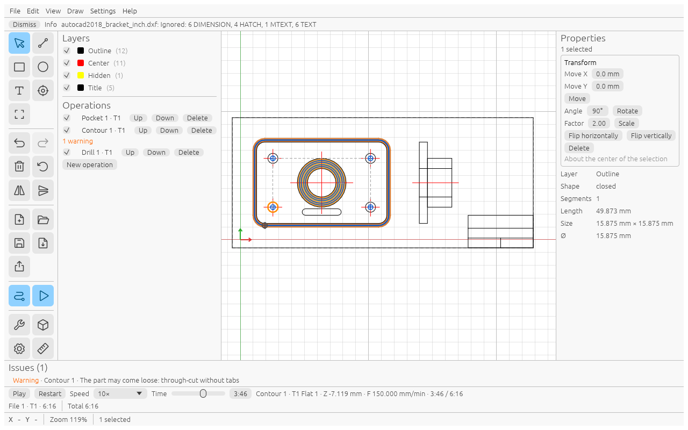

# Simulation

Open **View → Simulation** (or the play button in the sidebar). A bar appears above the status bar and the canvas
shows the job as it runs.

Controls:

- **Play** / **Pause**; Play at the end starts again from the beginning.
- **Restart** jumps to the start.
- **Speed**: 1× to 100× (10× by default).
- **Time**: drag the slider to any moment; this pauses playback.

The line next to the slider shows the operation, the tool, the current **Z** as a number, the kind of move
(Rapid, F *feed*/min, or Spindle start) and the time so far / total.
The second line shows the time of each file ("File 1 · T1 · 6:16") and the **Total**.

On the canvas the swept area is drawn as a band as wide as the tool. Darker means deeper. The circle is the tool
at the current moment.

Operations with errors are not simulated; the bar then says, for example, "Not simulated: 1 operation with errors".

## The time estimate

The total is an estimate. It assumes rapids at 2500 mm/min and no acceleration, adds 2 s for each spindle start,
and does not count tool changes or touch-off. Real jobs usually take longer; see [Limitations](limitations.md).
