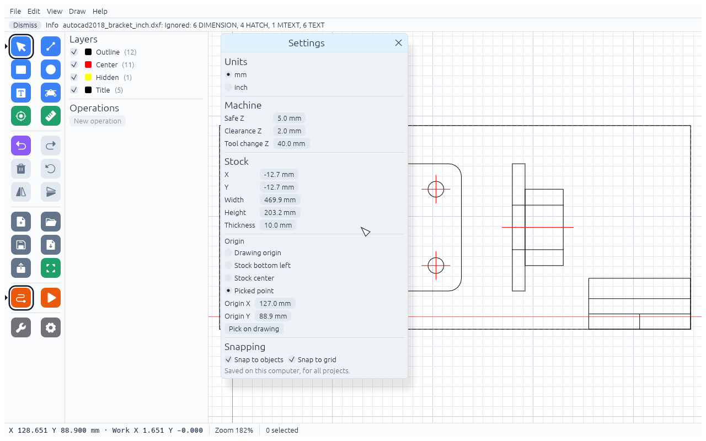
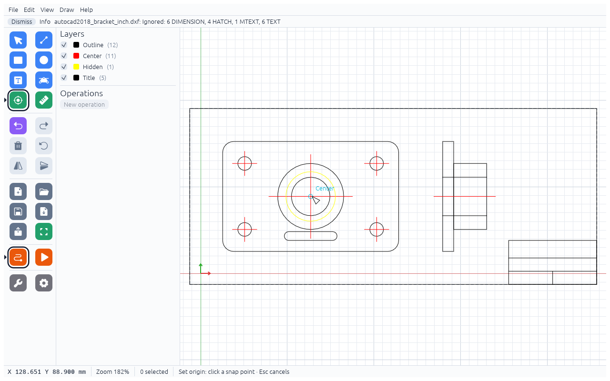

# Stock, origin and machine

## Stock

The **Stock** section of the Settings window (**File → Settings…**) sets the block of material: **X**, **Y** (its bottom-left corner in drawing coordinates),
**Width**, **Height** and **Thickness**. The first DXF import into a new project fits X, Y, Width and Height
around the drawing; the thickness stays at 10 mm until you change it.

## Work origin (XY zero)

Under **Origin** choose where X0 Y0 of the G-code is:

- **Drawing origin** – the 0,0 of the drawing
- **Stock bottom left**
- **Stock center**
- **Picked point** – a point you enter as Origin X / Origin Y, or pick on the drawing

To pick a point, click **Pick on drawing**, or press `O` (Set origin):

1. Hover over the drawing until the snap marker and its label (for example "Corner" or "Grid") show.
2. Click. The red and green arrows move to that point and the tool goes back to Select.
3. `Esc` cancels without changing anything.

With both snapping options off (Settings → Snapping) the clicked point itself is used.

Rounded corners have no corner snap point: the "Corner" snaps of a rounded rectangle are where the arcs start,
not the corner of the part. For a part with rounded corners pick the **Center** of a hole or arc, or set the stock to
your real blank and choose **Stock bottom left**.

The origin only shifts the X and Y numbers in the G-code. The sanity checks and the simulation always work on
the drawing as you see it.

## Z zero and depths

Z0 is always the **top of the stock**. Depths are entered as positive numbers (Depth 3 mm) and written to
the G-code as negative Z (`Z-3`).

## Machine

**Settings → Machine** has three heights above the stock top:

| Field | Default | Used for |
|---|---|---|
| Clearance Z | 2 mm | where plunges start, and the R plane of drill cycles |
| Safe Z | 5 mm | rapid moves between features |
| Tool change Z | 40 mm | where each file ends, so you can reach the collet |

Clearance Z must be above 0, Safe Z at or above Clearance Z, Tool change Z at or above Safe Z.

## Units

**Settings → Units**: **mm** or **inch**. This changes how values are shown and typed, and the units of the
G-code (`G21` or `G20`). The geometry itself does not change.
Length fields also accept `6,35`, fractions like `1/4` or `1 1/2`, and a unit: `3 mm`, `1/4 in` or `1/4"`.
