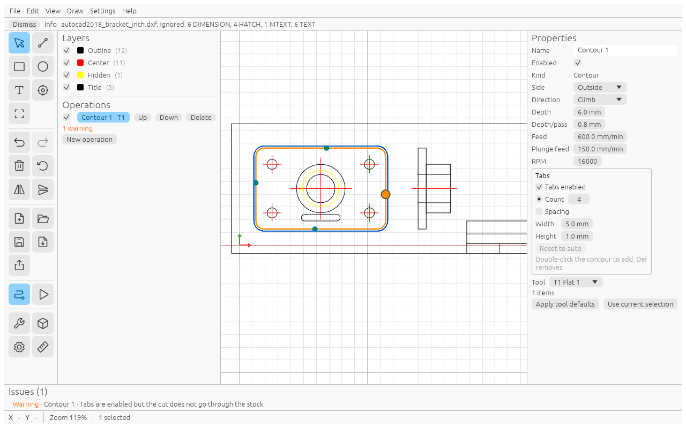

# Holding tabs

When a contour cuts all the way through, the part comes loose at the end and can be caught by the tool.
Tabs are small bridges of material left standing so the part stays in place. You cut or file them off afterwards.

## Turning them on

Tabs exist on **Contour** operations. In the operation's **Tabs** box:

- **Tabs enabled**
- **Count** – this many tabs, spread evenly (4 by default), or
- **Spacing** – one tab per this length of contour
- **Width** – length of material left along the contour
- **Height** – how high the tab is, measured up from the bottom of the cut

Automatic tabs are moved onto straight edges where possible. The tool only lifts over a tab on the passes that
are deeper than the top of the tab; the passes above it cut normally.

## Editing tabs on the canvas

With the Contour operation selected and tabs enabled, the tabs show as round markers:

- **Click** a marker to select it (it turns orange).
- **Drag** a marker to move it along the contour.
- **Double-click** on the contour to add a tab there.
- `Del` or Backspace deletes the selected tab.
- **Reset to auto** throws away your hand-placed tabs and goes back to Count / Spacing.

Once you edit the tabs of a contour, that contour keeps your positions and ignores Count and Spacing.

## Related warnings

- [Tabs are enabled but the cut does not go through the stock](sanity.md#tabs-are-enabled-but-the-cut-does-not-go-through-the-stock)
- [Tab height is not below the depth](sanity.md#tab-height-h-is-not-below-the-depth-d)
- [Only *k* of *n* tabs fit](sanity.md#only-k-of-n-tabs-fit-on-item)
- [No tabs on an open contour](sanity.md#no-tabs-on-item-it-is-not-closed)
- [Through-cut without tabs](sanity.md#the-part-may-come-loose-through-cut-without-tabs)
- [Tab sits on a corner](sanity.md#tab-k-sits-on-a-corner-and-may-be-weak-or-misplaced)
