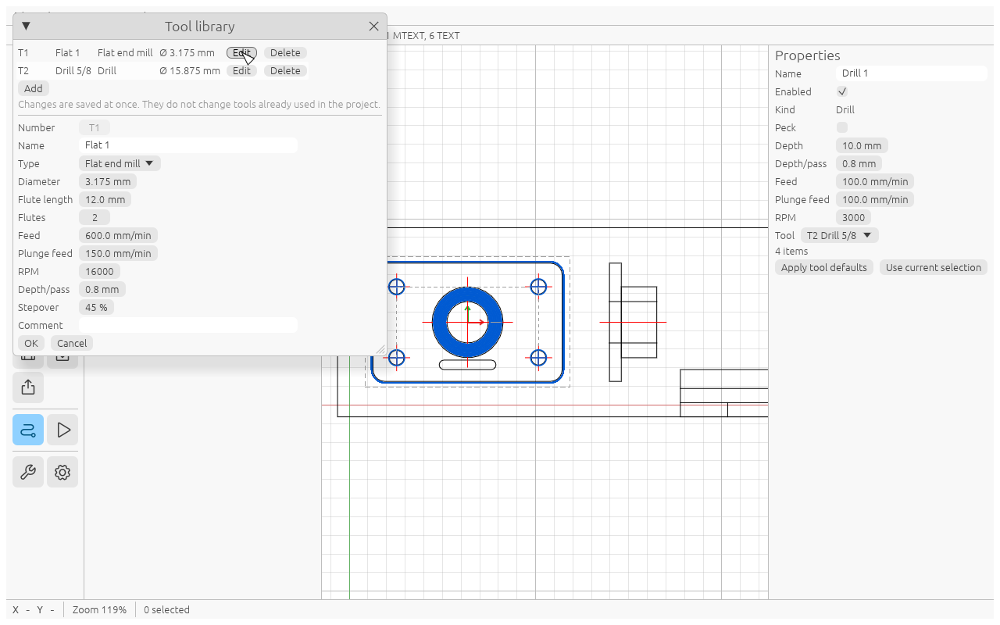

# Tools

Open **File → Tool library…** (or the wrench in the sidebar). The list shows each tool with **Edit** and
**Delete**; **Add** starts a new one.

| Field | Meaning |
|---|---|
| Number | the T number you will see in the G-code file names and headers; cannot be changed later |
| Name | free text, shown in the G-code header ("load T1 Flat 1") |
| Type | Flat end mill, Ball end mill, V-bit or Drill |
| V angle | only for a V-bit |
| Diameter | cutting diameter |
| Flute length | how deep the tool can cut |
| Flutes | number of cutting edges (for your notes) |
| Feed | default cutting feed |
| Plunge feed | default feed straight down |
| RPM | default spindle speed |
| Depth/pass | default depth of one pass |
| Stepover | default pocket stepover, % of the diameter |
| Comment | free text |

Click **OK** to store a tool. Changes are saved to `tools.json` at once (see [Install](install.md)).

## Library and project

The library is shared by all your projects. When you create an operation, the project keeps its own copy of
the tool, so the project still opens and exports on another computer. Editing the library later does not
change tools already used in a project. A new operation with the same T number refreshes the project's copy.

A new operation takes Depth/pass, Feed, Plunge feed, RPM and Stepover from its tool. If you change them in the
operation and want the tool's values back, click **Apply tool defaults**.

## What the type changes

- **Ball end mill** and **V-bit** are cut as if they were a flat cylinder of their diameter. There is no V-carving.
- A **Drill** type tool can only be used in a Drill operation; anything else gives the error
  "T*n* is a drill bit and cannot mill".
