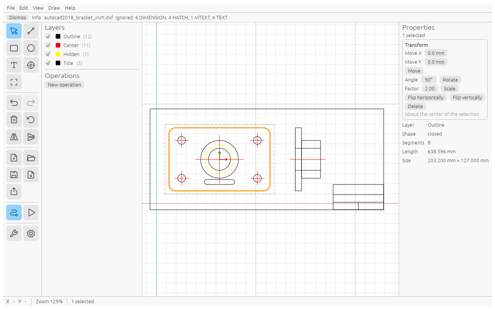
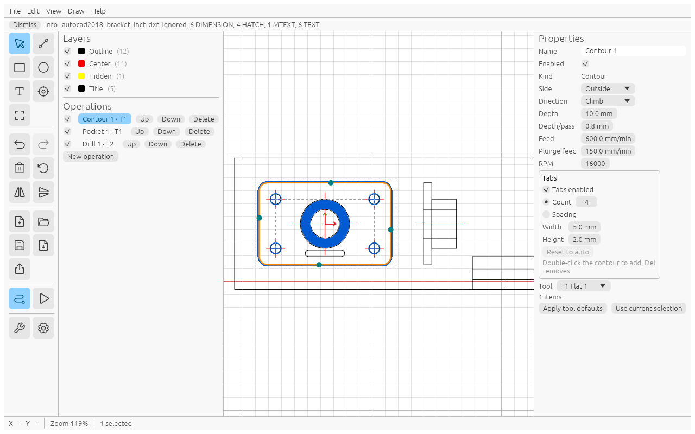

# Your first project

This walkthrough cuts the sample bracket: an outer contour with holding tabs, a ring-shaped pocket and four holes.
Download the drawing: [bracket.dxf](examples/bracket.dxf). It was drawn in inches; HobbyCAM imports it in mm.

## 1. Add two tools

Open **File → Tool library…**, click **Add**, fill in the form and click **OK**. Repeat for T2
(see [Tools](tools.md)):

| Number | Name | Type | Diameter | Flute length | Feed | Plunge feed | RPM | Depth/pass | Stepover |
|---|---|---|---|---|---|---|---|---|---|
| T1 | Flat 1 | Flat end mill | 3.175 mm | 12 mm | 600 mm/min | 150 mm/min | 16000 | 0.8 mm | 45 % |
| T2 | Drill 5/8 | Drill | 15.875 mm | 20 mm | 100 mm/min | 100 mm/min | 3000 | not used | not used |

A new tool starts with Stepover 40 %, so change it for T1. Use the values of your own tools if they differ.

## 2. Import the drawing

**File → Import DXF…** and pick `bracket.dxf`. A message lists what was skipped
(dimensions, hatches and text are not geometry). The stock is fitted around the whole drawing, including the side
view and the title block, so it is not your real blank yet. Open **File → Settings…** and enter the blank under **Stock**:
**Width 220 mm**, **Height 140 mm**, **X 17 mm**, **Y 19 mm** (so the bracket lies inside it) and **Thickness 10 mm**.
Only then can the "outside the stock" check warn you about anything real.

## 3. Pick the origin

Press `O` (Set origin), move the mouse to the centre of the large Ø76.2 circle until the "Center" label shows,
and click. The red and green arrows move there. On the machine you find the same point with an edge finder or by eye.
The outline's corners are rounded, so they have no corner point to pick; see [Stock, origin and machine](stock-origin.md).

## 4. Cut out the outline

Click the outer edge of the bracket so it turns orange, then click **New operation**.

Choose **Kind: Contour** and **Tool: T1 Flat 1**, then **Create**. In Properties set:

- Side **Outside**, Depth **10 mm**
- Tabs enabled, Count **4**, Width **5 mm**, Height **2 mm** (see [Holding tabs](tabs.md))

## 5. Pocket the ring

Click the Ø76.2 circle, Shift+click the Ø44.45 circle inside it, then **New operation → Pocket**, tool T1, **Create**,
and set Depth **3 mm**. The inner circle is an island, so only the ring between the circles is cleared.

## 6. Drill the holes

Select the four Ø15.875 circles (Shift+click), **New operation → Drill**, tool **T2 Drill 5/8**, **Create**, Depth **10 mm**.

## 7. Check and simulate

No Issues panel appears: the [sanity checks](sanity.md) found nothing. Open **View → Simulation**
and press **Play** to watch the job ([Simulation](simulation.md)).

## 8. Export

**File → Export G-code…**, type the name `bracket` and save. You get two files, one per tool:

- `bracket_1_T1.ngc` – the contour and the pocket (both use T1)
- `bracket_2_T2.ngc` – the holes

Next: [run them on LinuxCNC](linuxcnc.md).
